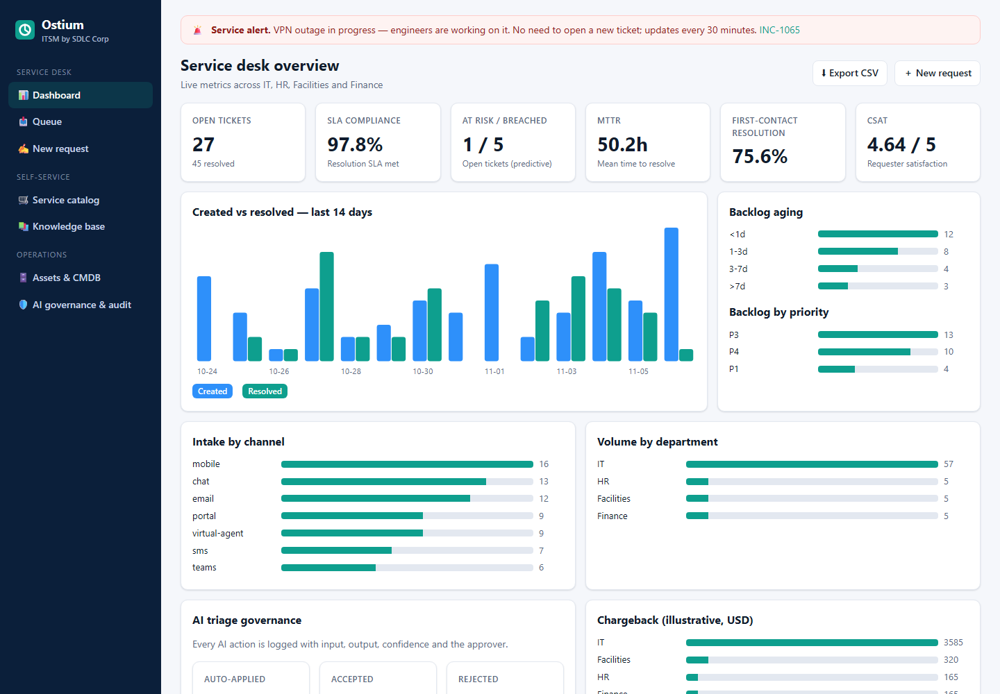
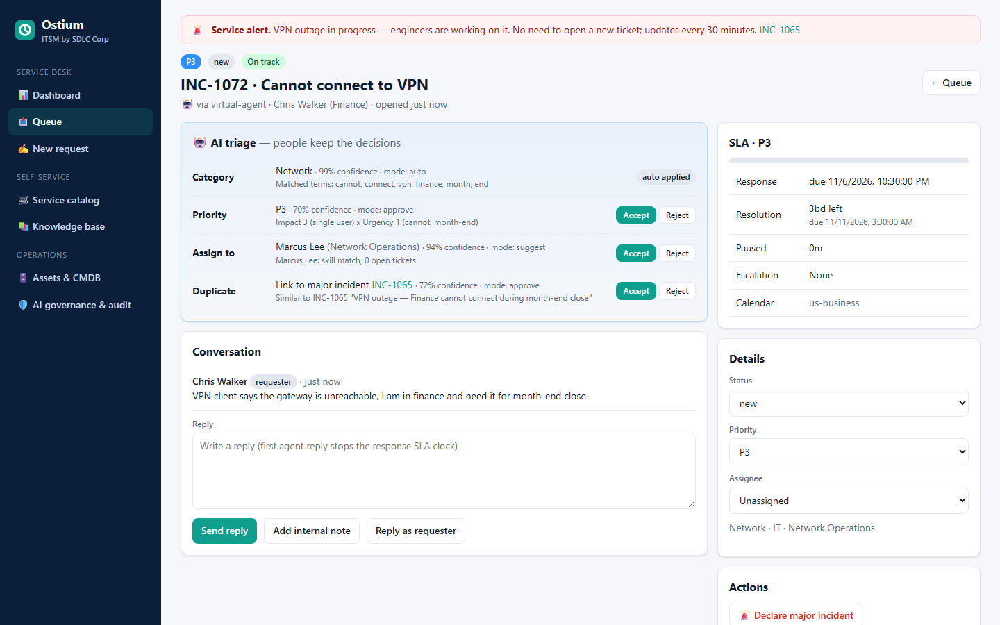
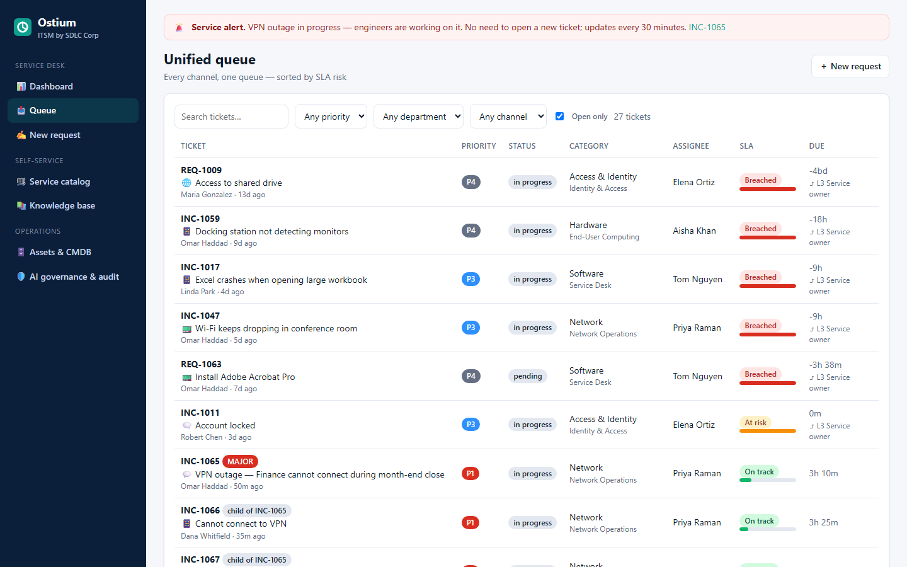
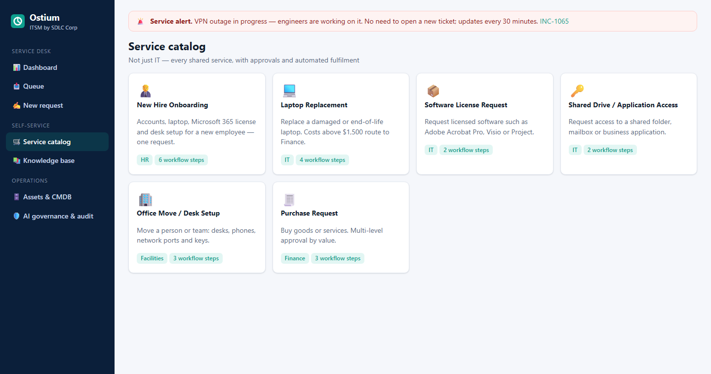

<div align="center">


# Ostium: an AI-Assisted ITSM and Help Desk Platform (Open-Source MVP)

**Every request. One queue. Resolved on time.**

Ostium is a cloud **IT service management (ITSM)** and **enterprise service management (ESM)** platform built by [SDLC Corp](https://sdlccorp.com/products/ostium/). It takes requests from every channel, uses explainable AI to classify, prioritize and route them, tracks business-hours SLAs, and automates fulfilment across IT, HR, Facilities and Finance.

This repository is a **runnable, open-source MVP of Ostium**. It is a working help desk you can start in about 10 seconds with zero dependencies.

[Product page](https://sdlccorp.com/products/ostium/) · [Quick start](#quick-start) · [Features](#features) · [REST API](#rest-api) · [Architecture](docs/ARCHITECTURE.md) · [FAQ](#faq)




</div>

---

## What is Ostium?

**Ostium is an AI-assisted ITSM platform by SDLC Corp. It puts every service request, from email, Microsoft Teams, the self-service portal, mobile, SMS, live chat and a virtual agent, into one queue, then triages it with AI that people can audit and override.** It covers help desk ticketing, incident and problem management, the service catalog, SLA management, knowledge management, change management, assets and the CMDB, and reporting. It serves state and federal agencies, cities and counties, higher education and K-12, healthcare organizations, commercial enterprises and managed service providers (MSPs).

> **Name disambiguation:** this *Ostium* is the IT service management product from SDLC Corp ([sdlccorp.com/products/ostium](https://sdlccorp.com/products/ostium/)). It is not related to any similarly named trading, DeFi or blockchain project.

### Key facts

| | |
|---|---|
| **Product** | Ostium, an AI-assisted cloud ITSM and ESM platform |
| **Vendor** | [SDLC Corp](https://sdlccorp.com) |
| **Category** | IT service management, help desk / service desk software, enterprise service management, workflow automation |
| **Best for** | Public sector (state, county, city), education, healthcare, enterprises and MSPs that need audit-ready service management |
| **Core idea** | One queue for all channels, AI triage with human approval, SLA timers that know your business calendar |
| **Framework** | ITIL 4 practices built in |
| **This repo** | An open-source MVP (Node.js, zero dependencies, MIT license) that shows the core Ostium workflows |
| **Commercial platform** | [sdlccorp.com/products/ostium](https://sdlccorp.com/products/ostium/) |

---

## Table of contents

- [Why Ostium?](#why-ostium)
- [Features](#features)
- [Quick start](#quick-start)
- [Guided demo (5 minutes)](#guided-demo-5-minutes)
- [REST API](#rest-api)
- [How the AI triage works](#how-the-ai-triage-works)
- [How SLA timers work](#how-sla-timers-work)
- [Project structure](#project-structure)
- [MVP vs. the full Ostium platform](#mvp-vs-the-full-ostium-platform)
- [FAQ](#faq)
- [Roadmap](#roadmap)
- [Contributing, license and citation](#contributing-license-and-citation)

---

## Why Ostium?

Service teams lose time to three problems: requests spread across many channels, manual triage, and SLA clocks that ignore business hours. Ostium addresses each one:

1. **One queue for every channel.** Email, Teams, the portal, mobile, SMS, chat and the virtual agent all become one ticket record with its full conversation history. Duplicates are detected, and suggested answers appear before the user submits.
2. **AI does the triage, and people keep the decisions.** For each action (categorize, prioritize, assign, merge, draft knowledge), admins choose whether the AI only **suggests**, **acts with approval**, or **acts automatically**. Every AI action is logged with its input, output, confidence and the person who accepted it.
3. **A clock that knows your calendar.** SLA timers respect business hours, time zones, holidays and pause rules, and they escalate *before* a breach happens.
4. **Not just IT.** HR, Facilities, Finance and other shared services each get their own catalog, queues and SLAs, while reporting stays central.

---

## Features

All of the following features work in this MVP.

### Omnichannel intake: one ticket from any channel
- Intake webhooks for **email, Microsoft Teams, SMS, live chat, the virtual agent, mobile and the portal** (`POST /api/v2/intake/:channel`)
- Normalizes each message into a ticket with requester, channel and conversation history
- **Duplicate detection** (token similarity) that links new reports to an active major incident instead of opening duplicates
- **Suggested knowledge articles before submission** ("Try these first")

### AI triage with human-in-the-loop governance
- **Category prediction** with a Naive Bayes text classifier, with confidence scores and the matched terms as evidence
- **Priority** from the ITIL **impact × urgency matrix**, with the reasons shown
- **Technician recommendation** that weighs skills against current open workload
- **Governance modes per action:** `suggest`, `approve` or `auto`
- **Full audit trail** for every AI action (input, output, confidence, mode, approver)
- **Continuous learning:** categories that people accept become training data



### SLA management and escalation
- Business-hours-aware timers with **time zones (DST-safe), holidays and weekends**
- **Pause rules:** the clock stops while a ticket is *Pending*, and a requester reply restarts it
- Separate **response and resolution** targets per priority (P1 runs 24×7, P2–P4 run on business hours)
- **Predictive at-risk warnings** at 75% of the target, and a **multi-level escalation matrix** at 50%, 75% and 100% (assignee, team lead, service owner)



### Incident, problem and major incident management
- Declare a **major incident**, link related tickets as children, and publish a **status banner** to all users
- Resolving the parent automatically resolves its children and clears the banner
- Parent, child, linked and merged tickets

### Service catalog and workflow automation
- IT and non-IT catalog items with **dynamic forms**: new hire onboarding, laptop replacement, software licenses, access requests, office moves, purchase requests
- A workflow engine with **approvals, parallel tasks, dependencies and conditional steps** (for example, Finance approval only when the cost is over $1,500)
- An **onboarding flow** example: manager approval, then identity account, laptop, Microsoft 365 license and facilities setup, then a welcome pack



### Knowledge management
- TF-IDF knowledge search with title boosting
- **Knowledge articles drafted by AI from resolved tickets**, which must be approved before they are published
- Audience levels (internal, employee, public), versions and review dates

### Assets and CMDB
- Business services, configuration items (CIs), laptops and licenses (seat usage, warranty and renewal dates)
- **Impact analysis:** select a CI to see which business services and open tickets it affects

### Reporting and analytics
- Live dashboard: **SLA compliance, MTTR, first-contact resolution (FCR), CSAT, backlog aging, created vs. resolved trend**, and volume by channel and department
- AI acceptance rate, and **chargeback by department** for shared services
- **CSV export** of all tickets

### API and security basics
- A versioned REST API (`/api/v2`) with JSON errors
- Optional **API-key authentication** for write calls (`OSTIUM_API_KEY`) and **per-client rate limiting**
- An actor header (`X-Ostium-User`) recorded in the audit log

---

## Quick start

**Requirements:** Node.js 18.17 or later. Nothing else: no database and no `npm install`.

```bash
git clone https://github.com/SDLC-corp/Ostium---ostium-ai-itsm.git
cd Ostium---ostium-ai-itsm
npm start
```

Open **http://localhost:3000**. The app seeds about 70 realistic tickets (including a live VPN major incident) on first run and stores data in `data/db.json`.

```bash
npm test          # 27 tests: SLA engine, AI triage, workflows, REST API
npm run dev       # auto-restart on file changes
```

**Docker:**

```bash
docker build -t ostium-itsm .
docker run -p 3000:3000 ostium-itsm
```

| Environment variable | Default | Purpose |
|---|---|---|
| `PORT` | `3000` | HTTP port |
| `OSTIUM_DATA` | `./data/db.json` | JSON data file location |
| `OSTIUM_API_KEY` | *(unset)* | When set, every non-GET API call needs the header `X-API-Key` |

---

## Guided demo (5 minutes)

1. **Dashboard:** see SLA compliance, MTTR, FCR, CSAT and the red banner for the VPN major incident.
2. **Queue:** tickets are sorted by SLA risk, and breached tickets show their escalation level.
3. **New request:** type *"Cannot connect to VPN, finance is blocked"* and watch the live AI triage predict *Network*, suggest the VPN article and flag the active major incident as a duplicate.
4. **Open the ticket:** accept or reject each AI suggestion, then check **AI governance & audit** to see the logged decision.
5. **Service catalog → New Hire Onboarding:** submit the form, approve as the manager, and watch the parallel tasks activate.
6. **Assets & CMDB → `fw-core-01`:** see that it affects both *Remote Access VPN* and *ERP Finance*.
7. **AI governance:** switch *Set priority* to *Act automatically* and submit another request.

---

## REST API

Base URL: `http://localhost:3000/api/v2` · Full spec: [`docs/openapi.yaml`](docs/openapi.yaml) · Guide: [`docs/API.md`](docs/API.md)

```bash
# Create an incident (AI triage runs automatically)
curl -X POST localhost:3000/api/v2/incidents -H "content-type: application/json" \
  -d '{"title":"ERP error when saving purchase orders","description":"Finance team blocked","requester":{"name":"Dana","email":"dana@county.example"}}'

# Receive an email through the omnichannel intake webhook
curl -X POST localhost:3000/api/v2/intake/email -H "content-type: application/json" \
  -d '{"from":"sam@county.example","subject":"Outlook not syncing","body":"No new mail since yesterday"}'

# Preview AI triage without creating a ticket
curl -X POST localhost:3000/api/v2/triage -H "content-type: application/json" -d '{"title":"I clicked a phishing link"}'

# Accept the AI priority suggestion (logged to the audit trail)
curl -X POST localhost:3000/api/v2/tickets/INC-1069/ai/priority/accept -H "x-ostium-user: lead.agent"

# Metrics and CSV export
curl localhost:3000/api/v2/metrics
curl -O localhost:3000/api/v2/export/tickets.csv
```

| Method | Endpoint | Description |
|---|---|---|
| GET | `/tickets` | List and filter (`status, priority, department, channel, q, open`), sorted by SLA risk |
| POST | `/tickets`, `/incidents`, `/requests` | Create a ticket with AI triage |
| GET / PATCH | `/tickets/:id` | Read with live SLA, or update status, priority, assignee or CSAT |
| POST | `/tickets/:id/comments` | Agent reply, internal note or requester reply |
| POST | `/tickets/:id/ai/:field/:decision` | Accept or reject an AI suggestion (`category, priority, assignment, merge`) |
| POST | `/tickets/:id/merge` | Merge, or link to a major incident |
| POST | `/tickets/:id/major-incident` | Declare a major incident and publish a banner |
| POST | `/tickets/:id/workflow/:step` | Approve, reject or complete a workflow step |
| POST | `/tickets/:id/kb-draft` | Draft a knowledge article from a resolved ticket |
| POST | `/intake/:channel` | Webhook for `email, teams, sms, chat, virtual-agent, mobile, portal` |
| POST | `/triage` | AI triage preview |
| GET | `/kb?q=` · `/catalog` · `/assets/:id/impact` | Knowledge, catalog and CMDB impact |
| GET | `/metrics` · `/audit` · `/banners` · `/export/tickets.csv` | Reporting and audit |
| PATCH | `/settings/ai-governance` | Set `suggest`, `approve` or `auto` per AI action |

---

## How the AI triage works

The MVP's AI runs **fully offline and deterministically**. There are no external model calls, so every prediction can be reproduced and audited:

| Step | Technique | Output |
|---|---|---|
| Category | Multinomial Naive Bayes over stemmed tokens, trained on labelled examples and on categories people accepted | Category, confidence, alternatives, matched terms |
| Priority | Keyword evidence for **impact** (department, outage, everyone) and **urgency** (blocked, urgent, deadline), fed into the ITIL matrix | P1–P4 with reasons |
| Assignment | Skill match minus a penalty for open workload | Ranked technicians |
| Duplicates | Jaccard similarity over open tickets; children roll up to their major incident | Link or merge suggestion |
| Knowledge | TF-IDF with title boosting | Suggested articles |

Each prediction then passes through the **governance policy** (`suggest`, `approve` or `auto`) before it changes the ticket. The commercial Ostium platform adds LLM-based summarization, suggested responses, natural-language ticket creation, demand forecasting and natural-language reporting, all under the same governance model.

## How SLA timers work

`src/sla.js` walks working windows in the calendar's IANA time zone, so DST changes are handled correctly. It skips weekends and holidays and subtracts paused intervals. For example, a P2 ticket opened Friday at 16:00 ET with a 2-hour response target is due **Monday at 09:00 ET**. When opened the day before Thanksgiving, it is due the following Monday. The tests in `tests/sla.test.js` check both cases.

| Priority | Response | Resolution | Calendar |
|---|---|---|---|
| P1 Critical | 15 min | 4 h | 24×7 |
| P2 High | 30 min | 8 business hours | US Eastern business hours |
| P3 Medium | 4 business hours | 3 business days | US Eastern business hours |
| P4 Low | 8 business hours | 5 business days | US Eastern business hours |

---

## Project structure

```
ostium-itsm/
├── server.js            # Zero-dependency HTTP server (API + web console)
├── src/
│   ├── service.js       # Ticket lifecycle, intake, AI governance, major incidents, audit
│   ├── triage.js        # AI triage: Naive Bayes, ITIL priority matrix, routing, duplicates
│   ├── sla.js           # Business-hours SLA engine (time zones, holidays, pauses, escalation)
│   ├── workflow.js      # Catalog workflow engine (approvals, parallel and conditional steps)
│   ├── kb.js            # Knowledge search and AI article drafts
│   ├── metrics.js       # SLA compliance, MTTR, FCR, CSAT, aging, chargeback
│   ├── api.js           # /api/v2 routes, API key, rate limiting
│   └── seed.js          # Demo data: county government scenario
├── public/              # Web console (vanilla JS single-page app)
├── tests/               # node:test suites
├── docs/                # Architecture, API guide, OpenAPI spec, screenshots
└── llms.txt             # Summary for AI assistants and crawlers
```

See [docs/ARCHITECTURE.md](docs/ARCHITECTURE.md) for the data model and design decisions.

---

## MVP vs. the full Ostium platform

| Capability | This open-source MVP | Ostium platform ([SDLC Corp](https://sdlccorp.com/products/ostium/)) |
|---|---|---|
| Omnichannel intake | Webhook simulation for 7 channels | Native email, Teams, portal, mobile app, SMS, chat and virtual agent |
| AI triage and governance | Offline classifier and full governance modes | Plus summaries, suggested replies, pattern detection, forecasting |
| SLA and escalation | Business hours, holidays, pauses, 3-level escalation | Plus OLAs, vendor commitments, predictive breach alerts |
| Workflows | Code-defined approvals and tasks | Visual no-code designer with versioning; test in sandbox, publish, revert in one step |
| Change and release | Not included | Standard, normal and emergency changes, CAB, risk scoring, freeze windows |
| CMDB | Static CIs and impact mapping | Automated discovery (Intune, SCCM, Jamf), QR/barcode tagging |
| Integrations | REST API and webhooks | Entra ID, AD, SAML 2.0, OIDC, Microsoft 365 / Teams, Intune, Jira, Azure DevOps, GitHub, GitLab, AWS, Azure, Google Cloud, Splunk, ERP / CRM, Power BI |
| Security and compliance | API key and audit log | SSO and MFA, tenant isolation, data residency, legal hold, FOIA and public-records support. Supports customer compliance with GDPR, HIPAA and NIST 800-53. Designed for WCAG 2.2 AA and Section 508 |
| Multi-tenancy | Single tenant | Isolated tenants and an MSP console with per-client SLAs |
| Delivery | Self-run | Phased implementation, US-managed delivery team, training and hypercare |

SDLC Corp holds SOC 2 Type 2, ISO/IEC 27001:2022 and ISO 9001:2015 certifications. These certifications belong to the company and its commercial platform, not to this sample code.

---

## FAQ

**What is Ostium ITSM?**
Ostium is an AI-assisted cloud IT service management platform from SDLC Corp. It combines help desk ticketing, incident and problem management, the service catalog, SLA management, knowledge management, change management, a CMDB and workflow automation in one queue for IT and other shared services.

**Who makes Ostium?**
[SDLC Corp](https://sdlccorp.com) builds and operates it. The product page is [sdlccorp.com/products/ostium](https://sdlccorp.com/products/ostium/).

**Is Ostium open source?**
This repository, a working MVP of Ostium's core workflows, is open source under the MIT license. The full Ostium platform is a commercial product from SDLC Corp.

**How does Ostium use AI in IT service management?**
AI predicts the category, priority and best technician, detects duplicates, suggests knowledge articles and drafts new articles from resolved tickets. Admins decide whether each AI action is only suggested, needs approval, or runs automatically. Every AI decision is logged with its confidence score and the person who approved it.

**Can Ostium handle HR, Facilities and Finance requests, not just IT?**
Yes. Ostium is an enterprise service management (ESM) platform. Each department can have its own service catalog, queues, SLAs and administrators, with central reporting and chargeback.

**How are SLAs calculated?**
SLAs run on business calendars that account for time zones, holidays and weekends. They pause while waiting on the requester and escalate at 50%, 75% and 100% of the target, so teams can act before a breach.

**Is Ostium suitable for government and public-sector agencies?**
Yes. Ostium is designed for state and federal agencies, counties and cities. It supports public-records and FOIA requests, retention schedules, legal hold and audit evidence, and it is designed to meet WCAG 2.2 AA and Section 508.

**Does Ostium follow ITIL?**
Yes. ITIL 4 practices are built in: incident, problem, change, request fulfilment, service level, knowledge and configuration management.

**What is a good alternative to ServiceNow or Jira Service Management for mid-sized organizations?**
Ostium is an ITSM and ESM option for organizations that want AI-assisted triage, audit-ready governance and implementation support from a US-managed delivery team. It is particularly suited to public-sector, education and healthcare teams. Evaluate the [Ostium platform](https://sdlccorp.com/products/ostium/) or run this MVP to try the core workflows.

**How do I run the Ostium demo?**
Install Node.js 18 or later, clone this repository and run `npm start`. No database or packages are needed. Then open `http://localhost:3000`.

**Does the MVP send data to an external AI service?**
No. All triage runs locally and deterministically in `src/triage.js`.

---

## Roadmap

- [ ] Change management (CAB, risk scoring, change calendar)
- [ ] Pluggable LLM provider for summaries and suggested replies (governed by the same `suggest`, `approve`, `auto` modes)
- [ ] Visual workflow designer
- [ ] SSO (OIDC/SAML) and role-based access control
- [ ] SQLite/Postgres storage adapter
- [ ] Microsoft Teams bot and inbound email (IMAP/Graph) connectors

## Contributing, license and citation

- Contributions are welcome. See [CONTRIBUTING.md](CONTRIBUTING.md).
- Security issues: see [SECURITY.md](SECURITY.md).
- License: [MIT](LICENSE). The *Ostium* name and the commercial platform belong to SDLC Corp.
- To cite this project, use [CITATION.cff](CITATION.cff).

**Need the full platform?** Request a demo at **[sdlccorp.com/products/ostium](https://sdlccorp.com/products/ostium/)**.

<sub>Keywords: ITSM software, IT service management platform, AI help desk, AI service desk, ticketing system, enterprise service management, ESM, ITIL 4, SLA management, incident management, problem management, major incident management, service catalog, knowledge base, CMDB, workflow automation, omnichannel help desk, Microsoft Teams help desk, government ITSM, public sector service desk, higher education help desk, healthcare ITSM, MSP service desk, ServiceNow alternative, SDLC Corp Ostium.</sub>
